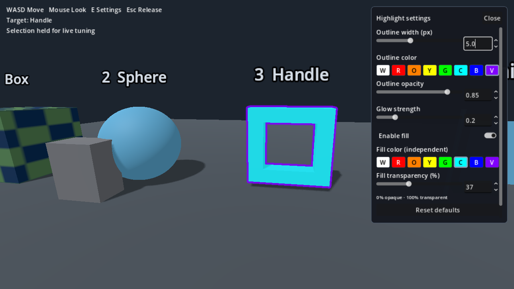

# Godot Interaction Highlight

[English](README.md) · v0.3.1 · [MIT 许可](LICENSE)

为 3D 物体添加两种高光：**只描边**，或**描边＋半透明填充**。不替换物体原来的材质。

## 一、先打开演示看看效果

1. 解压 **GodotInteractionHighlight 的 ZIP**，不要在压缩包里直接打开文件。
2. 打开 Godot 4.7 项目管理器，选择“导入”，选择解压目录里的 `project.godot`，然后打开项目。
3. 等待首次导入完成，双击打开 `scene/interaction_highlight_demo.tscn` 后按 **F6**，或按 **F5** 运行默认演示。
4. 用 WASD 移动、鼠标转向，准星指向物体后出现高光。
5. 按 **E** 打开调参面板：可以改粗细、边缘颜色、填充颜色和透明度。此时保留选中物体，暂停移动和射线更新。
6. 再按 E 恢复控制。Esc 关闭面板或释放鼠标；点击场景恢复鼠标捕获。

演示有七种原创模型，包含镂空、多网格、骨骼和 BlendShape。演示参数仅当前运行有效，不会自动保存，也不会修改原游戏设置。



## 二、导入你自己的 Godot 项目

这里的“导入模块”是**复制文件夹**，不是在项目管理器里再导入一个项目。

### 1. 复制模块

把解压目录里的整个 `addons/interaction_highlight` 文件夹，复制到**你自己的项目根目录**。项目根目录就是你自己的 `project.godot` 所在目录。

复制后应当是：

```text
你的项目/
├── project.godot                 ← 你自己的文件，不要覆盖
└── addons/
    └── interaction_highlight/
        ├── highlight_renderer.gd
        ├── highlight_style.gd
        ├── ...
        └── overlay.gdshader
```

保留文件夹中的所有文件，包括 `.uid`。如果已有 `addons`，只把 `interaction_highlight` 放进去。**不用覆盖你自己的 `project.godot`，也不要复制本项目的演示场景或 tests；不用在“插件”页启用任何东西。**

可选的宿主入门脚本不属于 addon。它位于本仓库的 `scripts/quick_start.gd`；如果需要检查器拖拽方式，只把它复制到自己项目的 `scripts/` 中。

### 2. 检查项目条件

- 使用 **Godot 4.7、Forward+**，不是 Mobile 或 Compatibility。
- 3D 渲染缩放为 **1.0**，关闭 TAA、FSR 和 XR。首次接入建议先关闭 MSAA。
- 先用普通、不透明的 `MeshInstance3D` 测试，确保相机能看到物体。

### 3. 不写代码，先给一个物体加高光

1. 打开你自己的 3D 场景。
2. 在场景根节点下面新增一个 **Node3D**，命名为 `HighlightController`。不要替换已有玩家或世界脚本。
3. 给这个新节点挂载：`res://scripts/quick_start.gd`。这个脚本是仓库里的宿主示例；复制到自己的项目时，也把它复制到自己的 `scripts/`，或者直接按下方代码接入。
4. 选中这个节点，在检查器里设置：
   - **Camera / camera**：把正在使用的 `Camera3D` 从场景树拖进来。
   - **Test Target / test_target**：把要描边的物体根节点拖进来。
   - **Highlight Style / highlight_style**：展开资源，修改高光参数。
5. 运行**你自己的场景**，该物体应当持续显示白色描边。

物体根节点可以是单个 `MeshInstance3D`，也可以是包含多个网格的 `Node3D`。**不要把整个世界根节点当作目标**，否则会选中它下面所有网格。

这一步是固定目标测试，不会自动添加准星、鼠标操作或 E 面板。那些属于完整演示，不属于高光核心。

## 三、修改粗细、颜色和填充

最简单的办法：选中 `HighlightController`，展开检查器里的 `highlight_style`。

| 想改什么 | 修改哪个字段 | 怎么填 |
|---|---|---|
| 只描边 / 描边加填充 | `mode` | `1` 只描边；`2` 描边＋填充 |
| 边缘粗细 | `outline_width_px` | 0.5～12 像素，例如 `5.0` |
| 边缘颜色 | `outline_color` | 点击颜色框选择颜色 |
| 边缘不透明度 | `outline_alpha` | 0～1；1 完全不透明 |
| 边缘微光强度 | `glow_strength` | 0～1；0 关闭微光 |
| 填充颜色 | `fill_color` | 与边缘颜色独立 |
| 填充不透明度 | `fill_alpha` | 0～1；`0.25` 表示 **75% 透明** |

只修改 `fill_color` 不会开启填充，必须把 `mode` 改为 2。关闭整个高光请调用清除方法，不要把 mode 改为 0。

Inspector 中的配置随场景保存；也可以把样式资源保存为 `.tres`，以后重复使用。多个控制器若使用同一个样式资源，会共享这些参数；需要不同参数时分别创建资源或设为独立资源。

核心默认白色 **2px**、填充关闭；完整演示默认 **2.5px**，并把填充预设为黄色。两者不是同一份设置。

运行时（初始化之后）也可以通过代码修改：

```gdscript
var controller = $HighlightController
controller.highlight_style.outline_width_px = 5.0
controller.highlight_style.outline_color = Color.RED
controller.highlight_style.mode = 2
controller.highlight_style.fill_color = Color.YELLOW
controller.highlight_style.fill_alpha = 0.25 # 75% 透明
controller.highlighter.apply_style(controller.highlight_style)
```

## 四、接入你已有的交互检测

上面的控制器创建完成后，你自己的射线或交互系统只需要调用：

```gdscript
# 准星选中物体时：传入该互动对象的根节点。
$HighlightController.show_target(interactable_root)

# 切换目标时再次调用 show_target，新目标会替换旧目标。
# 准星移开、打开禁用互动的菜单时：
$HighlightController.clear_highlight()
```

这些调用应发生在场景初始化之后。只有一个当前目标集合、一个绑定相机，不需要为每个物体创建一个控制器。核心负责画高光，**你的游戏负责决定高光哪个物体**。

如果不想使用 `quick_start.gd`，或需要换相机、指定网格集合、管理生命周期，见[完整接入代码](addons/interaction_highlight/docs/install.zh-CN.md)。

## 五、没有显示时先检查

1. 复制路径是否为 `res://addons/interaction_highlight/`？
2. `camera` 和 `test_target` 是否都已赋值？相机是否为正在使用的相机？
3. 目标是否包含非空的 `MeshInstance3D`？是否可见、没有完全被不透明物体遮挡？
4. 是否使用 Forward+，3D 缩放 1.0，关闭 TAA/FSR/XR？
5. 边缘不透明度是否大于 0？粗细是否在 0.5～12？
6. 查看 Godot 调试器。需要进一步排查时调用：
   ```gdscript
   print($HighlightController.highlighter.get_debug_state())
   ```

完整演示的 E 面板还提供默认折叠的诊断区，可查看状态、错误、覆盖纹理与线性化深度。[更多调试说明](addons/interaction_highlight/docs/api.zh-CN.md)。

## 六、项目结构

```text
scene/                         # 可直接打开运行的演示场景
scripts/                       # 演示、入门和宿主脚本
shader/                        # 演示诊断预览着色器
addons/interaction_highlight/  # 可复制的纯运行时核心模块
tests/                         # GPU 回归与包审计
docs/                          # 技术、接入和验收文档
```

只想运行示例时导入整个项目；只想接入时只复制 `addons/interaction_highlight/`，不要复制 `scene/`、`scripts/` 或 `tests/`。

## 七、技术、限制与开发文档

普通使用到此即可；以下内容供二次开发。

- [安装与生命周期](addons/interaction_highlight/docs/install.zh-CN.md)
- [全部参数和公共接口](addons/interaction_highlight/docs/api.zh-CN.md)
- [技术原理：目标深度、遮挡、像素描边、Canvas 混合](addons/interaction_highlight/docs/technical.zh-CN.md)
- [支持范围与限制](addons/interaction_highlight/docs/support.zh-CN.md)
- [完整演示说明](docs/playground.zh-CN.md)
- [测试与打包](docs/testing.zh-CN.md) · [贡献/修改入口](CONTRIBUTING.md) · [更新记录](CHANGELOG.md)
- [v0.3 验证记录](docs/release-verification.md)

实际验证环境为 Windows、Godot 4.7 stable Mono、Vulkan Forward+、RTX 5060 Laptop。代码为纯 GDScript，但没有单独验证非 Mono 引擎及其他平台/显卡。不承诺透明遮挡、材质裁剪、自定义顶点变形和多相机同时高光。

采用 MIT 许可，允许修改和再发布，请保留 [LICENSE](LICENSE)。本项目不包含原游戏、C#、MCP、个人存档或第三方模型。
